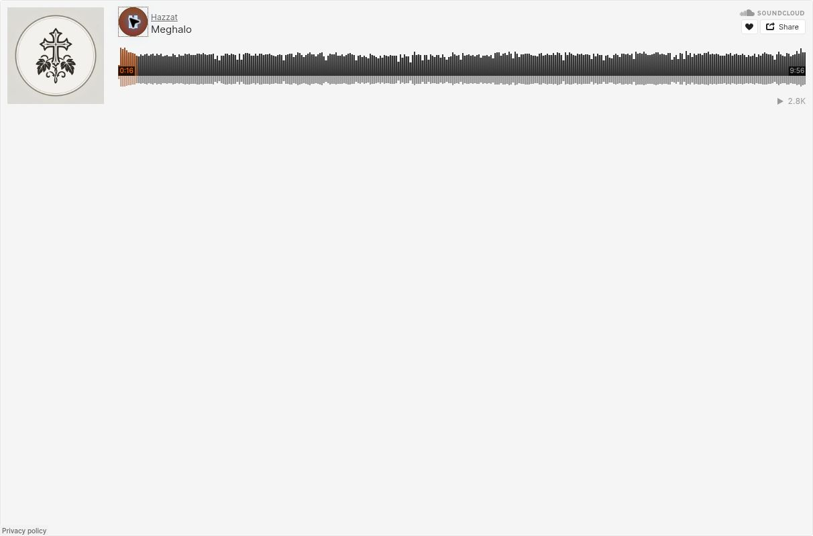

# Gradual SoundCloud audio migration

For [#283](https://github.com/CopticDevs/hazzat-web/issues/283), the website now chooses the audio experience from the existing `content.audioFilePath` string. This PR changes the reader, not published content. No recording URLs, schemas, Azure assets or deployments are changed.

## Reader behavior

- A validated public HTTPS SoundCloud artist/track link renders the official embedded player automatically. Audio autoplay is disabled.
- SoundCloud's supported `color` parameter uses Hazzat's charcoal ink (`#302c26`). The accent remains the same in light/dark site themes because the standard widget keeps its own light canvas and branding. A theme toggle does not change the iframe URL or restart playback. This is an accent adjustment, not a dark SoundCloud player.
- Azure MP3s and all other existing URLs retain the current image and external-link experience. Empty audio values remain empty.
- Recognition uses exact host checks for `soundcloud.com`, `www.soundcloud.com` and `m.soundcloud.com`, canonicalizing to `soundcloud.com`. Lookalike domains, credentials, nonstandard ports, private tokens, playlists and profile URLs are not embedded.
- Short share links such as `https://on.soundcloud.com/...` keep the legacy external-link experience. Resolve them to the full canonical artist/track URL before saving a migrated record. Do not put a player iframe URL or HTML into `audioFilePath`.
- Tracking parameters and fragments are stripped from recognized track URLs. The site never treats a matching word elsewhere in a URL as a SoundCloud host.
- The player includes a localized, labeled responsive iframe without the inline connection/cookie notice. Loading feedback is screen-reader-only. After the frame loads, no instructions, status text, link or Reload button appear underneath. A timeout or iframe error shows a localized SoundCloud fallback with an accessible new-tab announcement and a theme-colored icon. A frame load event does not prove playable audio; the site does not inspect cross-origin widget content or detect every playback failure.
- Replacing a recording under the same content ID removes the old iframe and resets loading state. Moving back to a legacy URL or leaving the audio view removes the iframe and cleans up its timer.

`SoundCloudUrl.ts` provides shared validation. `ContentAudio.tsx` selects the existing legacy markup or `SoundCloudPlayer.tsx`. The development review page uses that same player component.

## Migrate one recording at a time

Keep `schemaVersion: 5`, the content UUID, service placement references, order and labels unchanged when migrating the same recording. No provider field or schema version bump is required for this approach. The v5 validator and loader already accept and preserve the URL string.

1. Deploy the mixed-provider reader through the normal review/release process before changing recording URLs. This PR does not deploy it.
2. Verify the exact SoundCloud performance, language, public availability, embedding permission and recording rights. Save the original Azure URL in a rollback inventory.
3. Change only the intended v5 record's `content.audioFilePath` to its full SoundCloud track URL. Use a separate recording identity rather than silently replacing a different performance.
4. Test that record in context, including signed-out playback, unavailable-track fallback, switching/navigation and real mobile browsers. Revert the string if needed; the legacy experience still works.
5. Repeat for the remaining records. Remove the website's Azure/legacy handling only after confirming the intended feed no longer relies on it.

A fresh read during this implementation found **17 Audio records, all still pointing to Azure**. None was changed by this PR. Content JSON is served separately from the audio storage; replacing audio hosting does not require moving the JSON feed.

### Other readers and older feeds

The previous web reader opens any nonempty `audioFilePath` externally, so a migrated URL remains a link there rather than becoming an embed. Responsive/mobile web uses this renderer, but iOS Safari and Android Chrome behavior still need real-device checks.

Native-app compatibility and the current publisher/editor's URL restrictions are **not verified**. A native client expecting a downloadable MP3 may not accept a SoundCloud webpage URL. Check clients that consume the same feed before migrating their records. Leave frozen v3/v4 content unchanged.

Removing website legacy handling and deleting Azure files are separate decisions. Older feeds, native apps, cached content and direct links may still need those files even after v5 migration. Do not retire storage based only on the v5 count.

## Local review page

With the repository's supported Node version (Node 24 preferred):

```sh
npm ci --strict-peer-deps
npm start
```

Open `http://localhost:3000/Preview/SoundCloud`. The default recording loads automatically with audio autoplay off. Valid URL edits replace it after a 500 ms pause in typing. Clearing or invalidating the input removes it. Close stays dismissed until the URL changes or the sample is restored. Labels do not reload the frame. No input is saved.

The default recording is [**Meghalo by Hazzat**](https://soundcloud.com/coptichazzat/meghalo), supplied for **Great Lent Saturdays & Sundays → Liturgy → Meghalo**. Its public title and description match the supplied context and the current [v5 recording](https://d1zhmhuei1bwco.cloudfront.net/v5/content/81a874a9-5ab3-41a8-9265-fb657b238c05.json) and [service placement](https://d1zhmhuei1bwco.cloudfront.net/v5/seasons/great-lent-saturdays-sundays/services/liturgy-25.json).

The prototype association is content UUID `81a874a9-5ab3-41a8-9265-fb657b238c05`, hymn `meghalo`, season `great-lent-saturdays-sundays`, service `liturgy-25`. It is not proof that the Azure and SoundCloud files contain the identical performance. The published Meghalo record remains unchanged.

The review route has no navigation link and remains development-only. A normal production build **includes the shared migration renderer/player**, but excludes `/Preview/SoundCloud`, its form/CSS and the hard-coded Meghalo sample. `npm run preview` serves a production build and does not expose the review route.

## Verification and remaining checks

Passed locally:

- TypeScript and scoped lint for new production/player/preview code.
- Renderer/provider regression tests for mixed records, safe classification, legacy markup, schema preservation, frame replacement, rollback, timer cleanup and Arabic labels.
- Existing prototype tests for automatic loading, debounce/cancellation, close/reopen and stale events.
- Build-tooling checks and production build. Existing large-chunk and mixed OpenSheetMusicDisplay import warnings remain.
- Production JS/CSS check: shared player present; development-only route, form/CSS and default track absent.
- `git diff --check`.

The full repository has pre-existing lint failures; this change does not include unrelated cleanup. Full-suite totals and remote CI status are recorded in the PR.

The standalone official SoundCloud widget was checked in a browser: **Meghalo** by **Hazzat**, artwork, waveform, **9:56** duration, Play/Pause and elapsed time advancing to **0:16**. It was paused afterward, when SoundCloud showed its own promotional overlay. No login or unavailable-track error appeared. Audible output and full-track listening were not independently checked.



This is an unchanged screenshot of the **standalone official SoundCloud widget, not the integrated Hazzat UI**. Integrated-page browser verification/screenshots remain blocked because the available browser cannot reach the local development server. Responsive CSS is not proof of real-device behavior.

Before release, check:

- Mixed migrated/unmigrated records in the actual hymn view, desktop and narrow layouts, Arabic and light/dark appearance.
- Automatic frame loading without automatic audio, Play/Pause/seek and the timeout/error fallback.
- A missing/private/unavailable track, same-ID URL replacement, navigation Back/Forward and rollback to Azure, with no lingering playback.
- Keyboard/focus behavior, assistive technology and real iOS Safari/Android Chrome.
- Recording rights, privacy and applicable SoundCloud permission. The [player/widget terms](https://soundcloud.com/terms-of-use) include consent requirements for genre-focused sites; clarify the permission applicable to Hazzat before public rollout.
