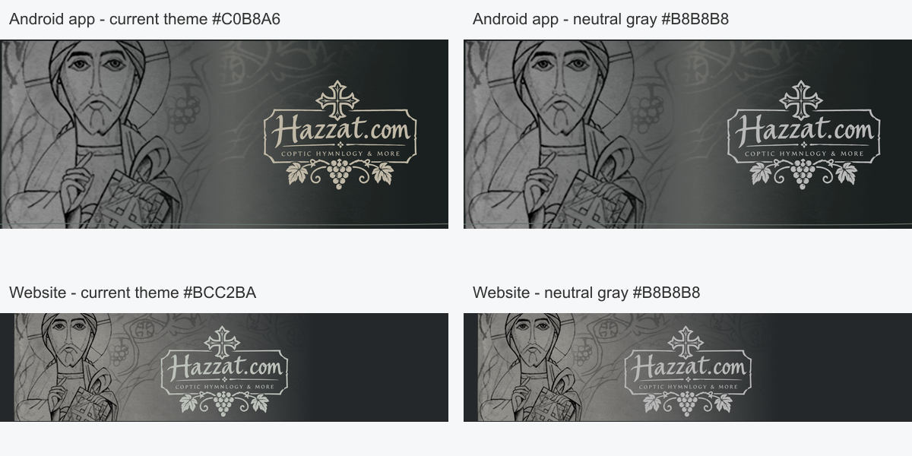

# Hazzat brand refresh

The full Hazzat.com mark and the separate cross-and-vine emblem come from the supplied artwork. Both masters are real SVG Bezier paths with transparent negative spaces: `src/images/logo.svg` and `src/images/brand-mark.svg`. Neither contains an embedded bitmap or depends on a font. The trace preserves the supplied lettering and ornaments.

The website wordmark uses `#303030` charcoal sampled from the Christ illustration's outlines in light mode. In dark mode, `--brand-ink` follows the existing theme's `--muted-ink` (`#BCC2BA`). The brand token also applies to print branding. Its header viewport retains the previous proportions so the navigation clearance below the Christ artwork does not change. A theme-aware SVG favicon uses the standalone emblem; browser/PWA/touch PNG fallbacks are exports from that same vector master.

Both generated PDF covers draw the same SVG logo as PDF vector curves, including imposed print booklets. Paper stays light regardless of the website theme. The legacy standalone `public/bookletFrontCover.svg` also contains the new vector logo.

The old logo was baked into the front-cover paper image. A background-only image-generation edit removed that logo before the new vector was layered onto it; the arch, paper texture and title rule were retained. The production PDF no longer depends on rasterizing the old cover SVG in a browser canvas.

Background edit prompt (built-in image tool): Remove only the old centered Hazzat.com logo, its cross, sign frame, lettering, tagline and small grape cluster. Fill the area with the surrounding gray paper texture. Preserve the large grapevine arch, textured paper, horizontal title rule, page dimensions and blank content areas. Do not add a replacement logo, text, symbols, gradients, lighting or ornaments.

The native implementation is in draft HazzatApp PR #47. Native Android uses VectorDrawable paths and iOS preserves SVG vector representation; installed app icon PNGs are rendered from the standalone SVG master. No production deployment or app release is included in this draft.

The theme-matched version on the left is implemented. The neutral-gray version on the right is a comparison only. The app retains its existing `#C0B8A6` artwork ink; the website retains its existing `#BCC2BA` theme ink.
