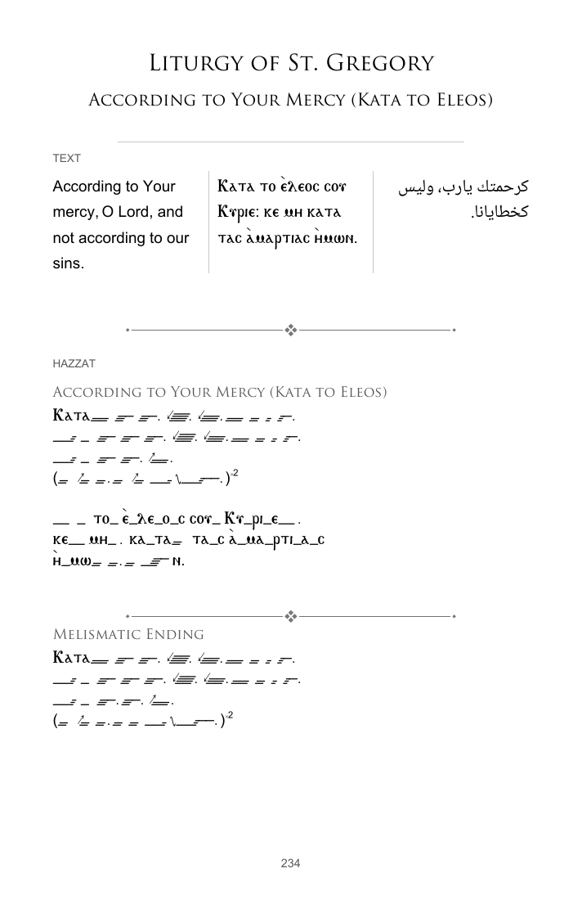

# Content availability audit and fixes

Audit date: October 30, 2026 (America/Los_Angeles). Independently refreshed dataset: `2026-10-30T13:47:33Z`.

## Result

One additional content-loss bug was found and fixed across **52 text records**, reused in **70 hymn/variation placements**, **39 services**, and **24 seasons**. It dropped 52 paragraphs: 11 text variations were entirely blank, while 41 lost a paragraph. The corrected reader preserves all **85 nonempty cells** in those paragraphs: 52 English, 26 Coptic, and 7 Arabic.

The complete audit was repeated against a fresh download. **Zero unresolved structural or content-loss findings remain in the audited snapshot.** All 34 seasons successfully generated an All Formats PDF, and the restored English passage was independently found in the PDF for all 70 affected placements.

## What changed

1. **Booklet text columns:** legacy lowercase labels (`english`, `coptic`, `arabic`) were valid in the published library and worked in the website reader, but the PDF table compared them with `English`, `Coptic`, and `Arabic` exactly. Both column discovery and paragraph matching now use a shared, case-insensitive language normalizer. This restores every affected paragraph, including variations with no title-case columns at all.
2. **Language fonts and availability:** the text-format availability path now uses the same canonical language labels when choosing English, Coptic, and Arabic fonts. The website text reader also uses the shared normalizer, including surrounding-whitespace handling, so these consumers cannot drift apart again.
3. **Prevent silent omissions:** the library validator now rejects unsupported language labels before rendering. All existing published labels pass. This is preventive validation; the audit found no unsupported languages in the live dataset.
4. **Regression coverage:** new tests cover lowercase-only and mixed-case variations, paragraph preservation, column order, language-specific fonts, comment flags, source immutability, website rendering, and invalid labels. A separate full-dataset audit can be rerun against a downloaded snapshot.

No hymn wording, translations, stored IDs, payload bytes, or public content objects were rewritten. The fix makes all existing records render correctly and continues accepting their valid legacy labels. The application changes require the normal PR/deployment process.

## Whole-library coverage

| Format | Records checked | Result |
| --- | ---: | --- |
| Text | 461 | Every language's text preserved in the PDF table and website reader |
| Hazzat | 331 | Payloads, availability, language blocks, and reader text pass |
| Vertical Hazzat | 31 | Payloads, availability, language blocks, and reader text pass |
| Musical Notes | 3 | MusicXML valid; all three published scores engraved and exported |
| Audio | 17 | Payload shape and reader rendering pass |
| Video | 6 | Payload shape and reader rendering pass |
| Information | 1 | Payload shape and reader text pass |

Additional checks:

- **850/850** published content payload hashes match their catalog entries.
- All **471** hymn identities and **84** retained service files validate, including two retained unlisted services.
- All **657** hymn placements and **1,216** variation references resolve; all 168 English/Arabic service projections preserve the printable variation count.
- All **826** printable library records pass the real booklet availability checks. All **847** non-score records pass the real website components; the three score records were separately engraved in the browser.
- The earlier missing-inner-`contentType` issue remains fixed: **446** current payloads omit that optional inner field, and their valid outer record types are accepted throughout the audit.
- Both independent snapshots contain **1,411** JSON objects, with no changed SHA-256 hashes between passes.
- Real English and Arabic Transfiguration exports pass, including Arabic print imposition. All **34/34** real All Formats seasonal exports pass.
- TypeScript and production build pass. Unit suite: **177 passing tests**, with two existing migration-dataset skips. The separate complete-dataset audit also passes with zero findings.

This audit checks schema, dependencies, availability, text preservation, language handling, and booklet generation. It does not assess translation accuracy or availability of third-party audio/video hosts, and does not certify native-app interfaces.

## Every affected placement

[Download the complete 70-row affected-placement list](affected-placements.csv). Each row includes the season, service, hymn, placement title, content UUID, affected paragraph number, previous behavior, fix, and PDF verification result. Multiple placements can share one corrected record.

| Season | Affected placements |
| --- | ---: |
| Annual | 6 |
| Apostles Feast | 1 |
| Ascension | 2 |
| Bright Saturday | 2 |
| Epiphany | 2 |
| Feast of Circumcision | 1 |
| Feast of the Cross | 7 |
| Funeral | 3 |
| Glorifications | 3 |
| Great Lent - Saturdays & Sundays | 1 |
| Great Lent - Weekdays | 1 |
| Nairouz | 1 |
| Nativity | 2 |
| Nineveh's Fast | 1 |
| Passion (Pascha) Week - Covenant Thursday | 3 |
| Passion (Pascha) Week - Good Friday | 2 |
| Passion Week - General Hours | 5 |
| Pentecost | 3 |
| Resurrection | 3 |
| Saint Mary's Fast/Feast | 4 |
| The Lord's Entry into Jerusalem (Palm Sunday) | 4 |
| The Lord's Entry into the Temple | 1 |
| The Wedding at Cana of Galilee | 1 |
| Transfiguration | 11 |

[Machine-readable audit results](audit-summary.json) include before/after counts, source provenance, all 34 export results, and all 70 paragraph checks.

## Rendered example

“According to Your Mercy (Kata to Eleos)” previously produced a blank text variation because all three language labels were lowercase. This page from the full Annual booklet now includes English, Coptic, and Arabic text:



## Reproduce

From the repository root, download the complete public dataset (HTTP GET only), including the retained service inventory:

```powershell
python scripts/download-content-audit.py .audit/snapshot https://d1zhmhuei1bwco.cloudfront.net docs/content-availability-audit/retained-services.json
$env:HAZZAT_CONTENT_AUDIT_DATASET = (Resolve-Path .audit/snapshot).Path
$env:HAZZAT_CONTENT_AUDIT_OUTPUT = "$env:HAZZAT_CONTENT_AUDIT_DATASET/results.json"
$env:CI = 'true'
npm test -- --watchAll=false --runInBand --testMatch '**/src/testSupport/ContentAvailability.audit.tsx'
```

The dataset test reads all catalog records and all service files; it fails on a missing dependency, changed catalog hash, rejected printable variation, changed/dropped text, invalid score, or lost service variation. The downloader checks that the public inventories did not change during collection.
