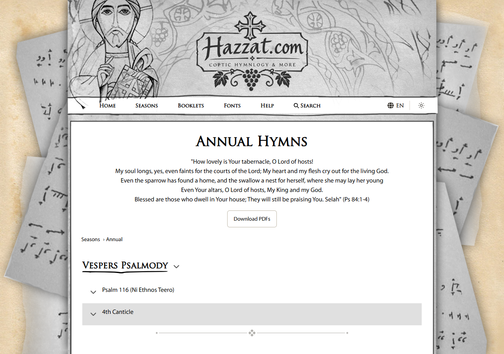
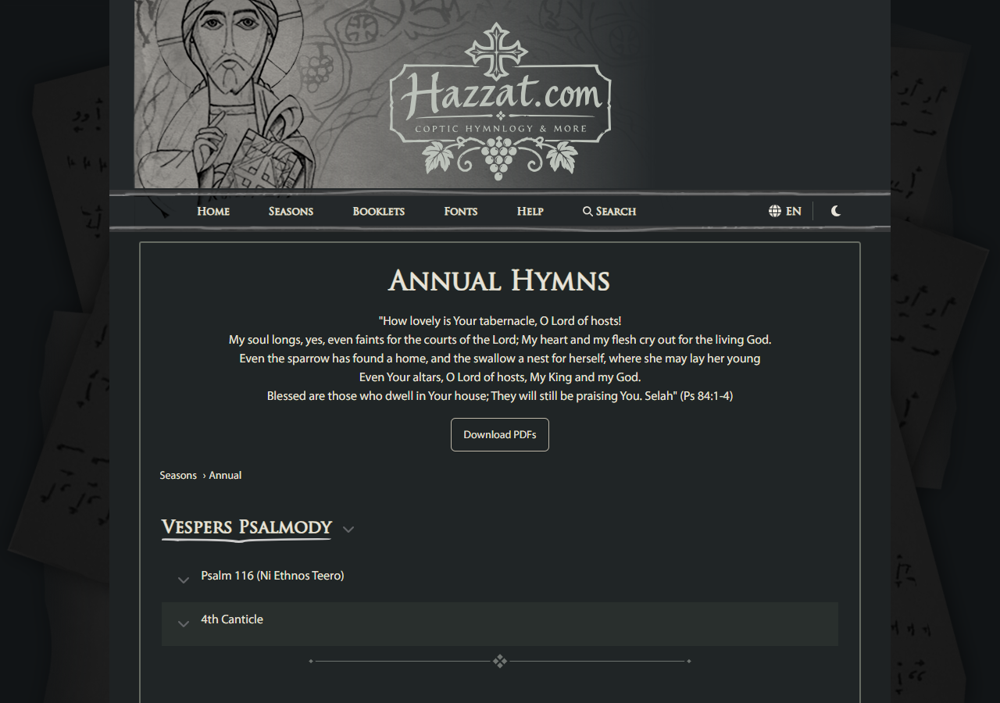
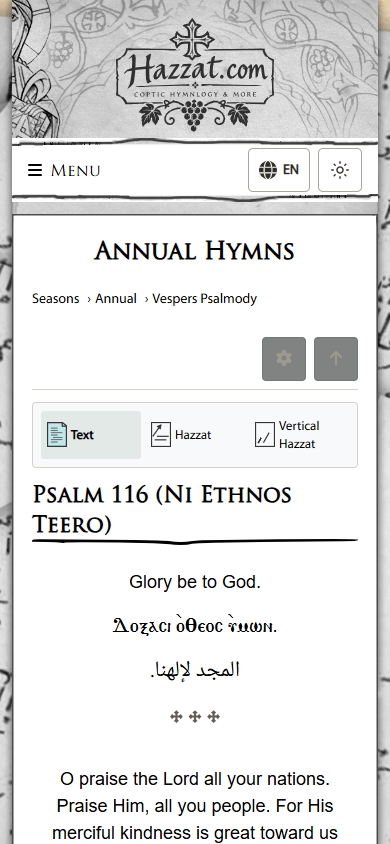
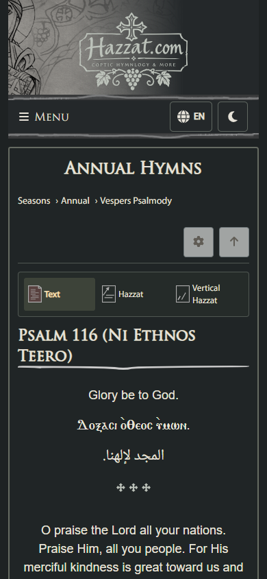

# Theme-aware cross separators

The shared `CrossDivider` now uses `--muted-ink`, and both SVG variants use `currentColor` instead of fixed dark fills. This covers service dividers, full content dividers, and the small crosses in narrow-screen text content. Existing artwork geometry, opacity, dimensions and spacing are preserved.

Verified against the production build with real Annual season content at 1280px and 390px widths. Switching the theme changes the SVG fills from `#625e55` to `#bcc2ba`; printing from dark appearance returns to the existing light-paper ink. No page overflow or browser errors were observed. Existing theme/content tests passed (14 tests), as did the production build. Measured browser values and sampled routes are in `verification.json`.

| Service divider, light | Service divider, dark |
|---|---|
|  |  |

| Narrow-screen text, light | Narrow-screen text, dark |
|---|---|
|  |  |
